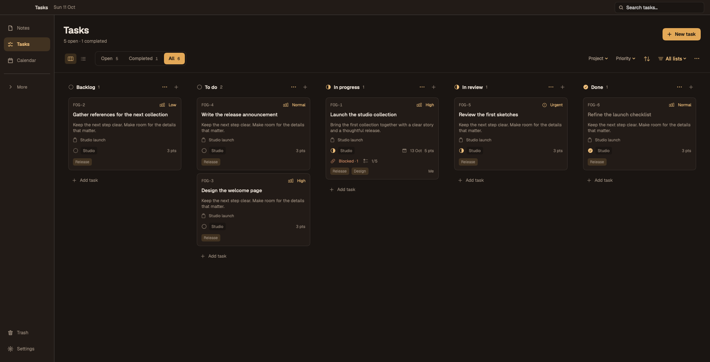
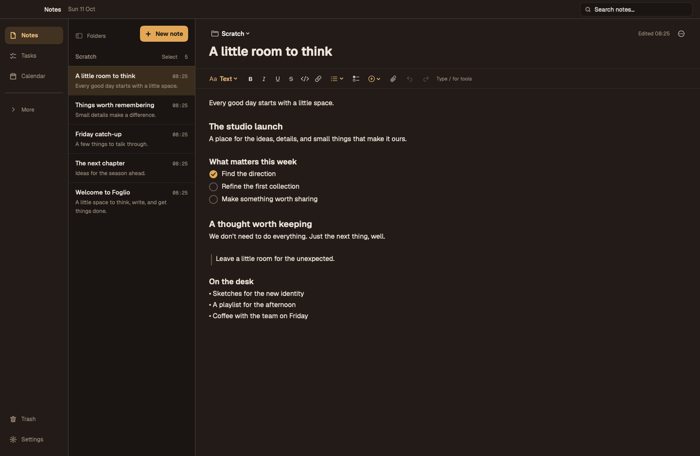
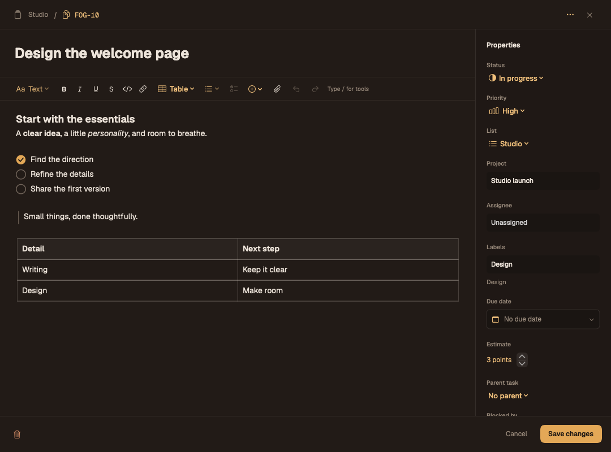
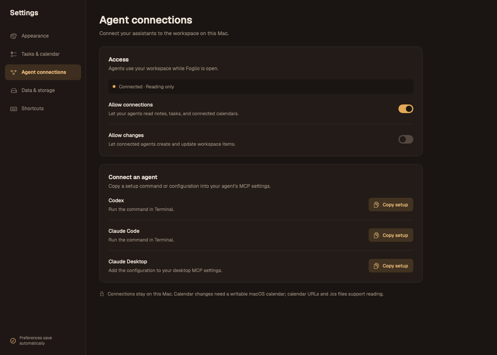

# Foglio

A native Mac workspace for notes, tasks, and your calendar—with a local MCP connector for your agents.

Write in a familiar editor, organize tasks on a board or list, and turn meetings into notes and follow-ups. Choose from eight themes; your notes stay in Markdown and your task data stays on your Mac.



*Actual app renders from the test preview fixtures. All notes, tasks, and connection states shown here are examples.*

## A closer look

<table>
<tr><th>Notes</th><th>Task details</th></tr>
<tr>
<td></td>
<td></td>
</tr>
</table>

- **Notes:** rich text, headings, numbered and unordered lists, circular checklists, quotes, code, tables, links, and attachments. Markdown files remain readable outside Foglio.
- **Tasks:** board and list views, drag between or within status columns with saved manual ordering, custom statuses, stable `FOG-42` ticket IDs, priorities, projects, assignees, labels, due dates, estimates, subtasks, and blocking relationships.
- **Calendar:** read from macOS Calendar, a calendar URL, or an `.ics` file. Create a meeting note or a follow-up task without leaving the workspace.
- **Make it yours:** eight palettes, a themed date picker, a floating bar, quick capture, and focused Settings pages.
- **Take your work with you:** export readable Markdown and a restorable archive with attachments. Import asks before replacing your library.

## Get started

The current preview targets **Apple silicon Macs with macOS 14 or later**. Build locally with Swift 6 and the macOS SDK:

```sh
make dmg
./scripts/install.sh build/Foglio.app
```

The DMG is written to `build/Foglio-0.5.0.dmg`. The installer replaces `~/Applications/Foglio.app` and keeps the previous app as a backup. This is a locally signed preview, rather than a notarized public release.

For development, use `make build`, `make app`, or `make test`. The tests run as the `FoglioTests` executable; see [Package.swift](Package.swift) for the Command Line Tools testing limitation.

The [landing page](website/README.md) provides the app preview and downloadable DMG:

```sh
npm --prefix website run build
npm --prefix website run dev
```

Open **http://127.0.0.1:4173** and keep the server running. The site has no npm dependencies.

## Connect your agents

Foglio ships **FoglioMCP**, a local **MCP stdio server** for **Codex, Claude Code, and Claude Desktop**. Agents can read and organize the same workspace you use in the app, through **26 tools**. Requests go to the running app, so updates appear in its live store and editor data.



1. Open **Settings → Agent connections** and enable **Allow connections**. Access starts with reading only.
2. Copy the setup for your agent. Use the command in Terminal for Codex or Claude Code, or add the JSON configuration to Claude Desktop’s MCP settings.
3. Keep Foglio open, and start a new agent session or reconnect so it discovers the tools.
4. Enable **Allow changes** when you want agents to create or update content.

For an app installed in your personal Applications folder:

```sh
# Codex
codex mcp add foglio -- "$HOME/Applications/Foglio.app/Contents/MacOS/FoglioMCP"

# Claude Code
claude mcp add --transport stdio --scope user foglio -- "$HOME/Applications/Foglio.app/Contents/MacOS/FoglioMCP"
```

The helper uses a private Unix socket. No HTTP server, hosted bridge, API key, or npm package is needed. Access switches apply to all connected local agents; each agent may still send workspace content to its model provider according to that agent’s configuration.

### What you can ask

- “Create a launch checklist in my Studio notes folder.”
- “Add an In review status and move FOG-42 there.”
- “Show high-priority tasks for the Studio launch project.”
- “Read tomorrow’s meetings and create notes and follow-up tasks for the design review.”

### All 26 connector tools

Read tools work with connection access enabled. Write tools also require **Allow changes**.

| Tool | What it does | Access |
| --- | --- | --- |
| `foglio_status` | Check the connection, permissions, and calendar source. | Read |
| `task_statuses` | List ordered statuses, stable IDs, and workspace revisions. | Read |
| `task_status_create` | Add a custom board status within a workflow category. | Write |
| `task_status_update` | Rename or reorder a status while keeping its ID. | Write |
| `task_lists` | List task lists, independently of board statuses. | Read |
| `task_list_create` | Create a task list. | Write |
| `tasks_list` | Search tasks in saved manual order and filter by list, status, project, or priority. | Read |
| `task_get` | Read a task and its revision by UUID or ticket ID. | Read |
| `task_create` | Create a task with its description and properties. | Write |
| `task_update` | Edit task content, properties, or relationships. | Write |
| `task_move` | Move a task between lists/statuses or place it before/after another card. | Write |
| `note_folders` | List note folders and their note counts. | Read |
| `note_folder_create` | Create a note folder. | Write |
| `notes_list` | Search notes by title or content, with summaries. | Read |
| `note_get` | Read a note’s full Markdown and current revision. | Read |
| `note_create` | Create a Markdown note in a folder. | Write |
| `note_update` | Update a note’s title or full Markdown body. | Write |
| `note_move` | Move a note to another folder. | Write |
| `calendar_list` | List calendar sources and their editing capabilities. | Read |
| `calendar_events` | Read events within a date range, up to 92 days. | Read |
| `calendar_event_get` | Read an event and its current revision. | Read |
| `calendar_event_create` | Create a personal timed event in a writable macOS calendar. | Write |
| `calendar_event_update` | Edit an eligible personal event. | Write |
| `calendar_event_move` | Reschedule an event or move it to a writable calendar. | Write |
| `meeting_note_create` | Create a note linked to a meeting. | Write |
| `meeting_task_create` | Create a follow-up task from a meeting. | Write |

### Task properties and editing behavior

Task creation and updates accept a Markdown description, list, status, priority, project, assignee, labels, due date, estimate, parent task, and blocking tasks. Assignees are local text labels; they do not create accounts or send notifications. Use `task_statuses` to discover custom status IDs. Ticket IDs stay stable when titles or statuses change.

Read an item before editing and pass its current `revision`. Stale edits return `conflict`; task edits return `resource_busy` while that task’s editor is open. Status renames and reordering use the workspace revision returned by `task_statuses`. Notes and task descriptions support the editor’s Markdown formats; the tools update content directly rather than simulating typing.

Within a task column, drop above or below a card to rearrange it. Drop on the column background to put it last. Ordering survives restarts and archive export/import; new tasks appear first. Board and list share **Manual order**. Choosing a date/priority sort is still available; dragging or using **Move up / Move down** switches back to Manual order. Filtered views move only the chosen task and preserve the other tasks' relative order.

Agents can use `task_move` with one of `before_id` / `after_id` (UUID or ticket ID) and a fresh `order_revision` from `tasks_list` or `task_get`, alongside the task's content `revision`. The anchor must be in the destination status; optionally supply `status` to move across columns while positioning. Intervening reorders, additions, deletions, or status/list changes return `conflict`. See the [connector ordering example](connectors/README.md#rearrange-tasks).

Repository contributors and agents should follow [AGENTS.md](AGENTS.md) for app, connector, documentation, website, screenshot, validation, and release follow-ups.

Calendar reading works with the selected source. Calendar writes require existing full macOS Calendar access and a writable calendar. The connector edits personal, non-recurring timed events; invited meetings and all-day events are outside its editing support. Calendar URLs and `.ics` files support reading, meeting notes, and follow-up tasks.

There are no delete, arbitrary-file, or shell-execution tools. See the [connector guide](connectors/README.md) for configuration, parameters, permissions, examples, and troubleshooting.

## Screenshots and verification

The images above come from the native test renderers, using temporary libraries and isolated preferences. They contain no personal notes or tasks. [Screenshot provenance and regeneration](docs/images/README.md) explains how to update them. The optional renderers run alongside the app and connector tests.
